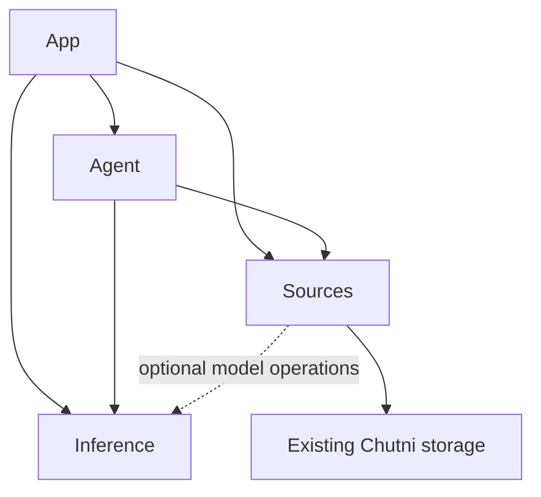

# Samosa architecture rebuild plan

User steering, 2026-11-20: extract the existing working implementations rather
than redesigning the system; no Python in runtime, tooling, packaging, tests or
CI; make the refactor work natively on this Mac first. Docker/Linux work is
deferred and does not block current Mac qualification. See the governing rules
and ordered work in [current priorities](ARCHITECTURE_REBUILD_PRIORITIES.md).
These directions override older conflicting implementation/platform instructions.

Status: Sources complete; Inference areas1–2 complete, area3 lifecycle/readiness active as of2026-10-17. Agent, App, assembly and retirement remain open. See [current status](ARCHITECTURE_REBUILD_STATUS.md).
The full scope below remains authoritative; historical checkpoints retain their original dates.

Companion: [verification plan](ARCHITECTURE_REBUILD_VERIFICATION.md). Every
change below has a matching verification section with the same ID.
Implementation agents should begin with the bounded assignment in the
[start and resume guide](ARCHITECTURE_REBUILD_START.md).

## Objective and scope

Make Samosa understandable, cohesive, independently testable and bounded under
load. Repository count is a packaging decision, not an architectural objective.
The target is a replacement for the gateway's structure, not its preservation.

### Reuse working monolith implementations first

User clarification on 2026-10-17: the goal is to split the existing codebase into
separate, individual, modular repositories, reusing as much of the code already
created as possible. This is an extraction and ownership migration, not a mandate
to reinvent the implementation. Move working code and its useful tests into the
responsible repository; adapt interfaces, configuration and dependencies only
where needed to establish the boundary or satisfy an existing requirement.

Before adding an implementation, inspect both the monolith and the destination
component for an existing implementation to move, wire or consolidate. Record the
specific missing behavior or demonstrated defect when new code is necessary.
Package qualification supports the split; it must not become a prerequisite for
moving otherwise reusable code. Preserve the required acceptance gates before
declaring completion or retiring a production path.

Execution rule confirmed by the user on2026-10-09: useful workflows already worked
in the Samosa monolith. This rebuild should extract those working implementations
into their owning components and separate repositories, preserving their useful
behavior. Inspect the existing implementation and its tests before designing a
replacement. Reuse existing parsers, media decoders, OCR, model engines, search
adapters and workflow code wherever they satisfy the target requirement.

For each migration, identify the monolith entry point, reusable implementation,
dependencies that must move or become public interfaces, and existing tests that
prove the behavior. Move or adapt that implementation, make ownership/configuration
explicit, and verify the same workflow independently and through the assembled
product. Record a concrete reason when existing code cannot be reused; structural
preference alone is not a reason to rewrite a working engine.

Keep migration, necessary boundary fixes and genuinely new capabilities distinct
in plans and qualification records. New capabilities remain in the full scope
where required by C01–C14, but must not be described as unavoidable extraction
work. Fix boundary failures and defects demonstrated by evidence; avoid expanding
each extraction into an unrelated redesign or speculative hardening project.

Do not copy the shared `Gateway` structure into several smaller services. Adapt
its working leaf implementations to explicit component-owned inputs, state and
public dependency interfaces. Legacy route/state compatibility is required only
for identified callers or valuable datasets; preserving useful behavior does not
require preserving every internal structure or historical deployment script.

Concrete reuse candidates for the remaining Sources work are recorded below.
These are extraction starting points, not claims that migration is complete.
Inspect their existing callers/tests and the extracted equivalent before changing
behavior. Keep the working engines and SDKs as dependencies behind public APIs.

| Work | Existing monolith entry points to reuse first | Boundary adaptation |
|---|---|---|
| Transcript windows/cache | `audio_transcript_window_count`, `audio_wav_window_create`, `audio_compressed_window_create`, `audio_window_evidence_from_srt`, `audio_window_evidence_load` in `src/samosa_gateway.c`; pinned `tools/samosa_voice_runtime.sh` | Sources owns immutable media, window/cache/timeline state; Inference owns the existing Whisper engine. Preserve useful behavior and correct demonstrated timing defects. |
| Transcript/model publication and enrichment | `chutni_store_model_text`, `chutni_store_derived_text`, `chutni_enrich_source`, `chutni_flush_file_outputs` in `src/samosa_gateway.c`; existing Chutni public SDK | Extract output construction, producer/model provenance and batch workflow. Adapt configuration and receipts to Sources ownership; preserve recognized text as derived model output. |
| Visual analysis | `visionpsy_session_inspect`, `vision_read_ocr`, `image_data_uri_with_limit` in `src/samosa_gateway.c` | Reuse the working backend interaction behind public Inference; Sources owns prepared pixels/timestamps and derived captures. Inspect existing tests before choosing any replacement. |
| Fetch/search and freshness | `curl_fetch`, `fetch_public`, `web_search_presets`, `web_search_build`, `web_search_run`, `jobs_watch_delta` in `src/samosa_gateway.c` | Reuse provider mappings, acquisition and delta behavior where suitable; compare with the already extracted Sources adapters/queues before extending them. |

For the next audio discovery/freshness integration, begin with
`attachment_audio_decode_probe_path` in `src/samosa_gateway.c` and the native
`--probe` implementation in `src/samosa_audio_decode.mm`, then compare their
duration/stream checks with the extracted Sources media worker. The original
probe is macOS-specific; retain its useful behavior through the existing
platform adapters rather than introducing a new media engine. Compare
`jobs_watch_delta` with Sources' existing inventory/watch/index runtime before
connecting new audio jobs. Use the existing queue and its checkpoints.

Test-tool conversion required by the native-only plan must preserve existing
acceptance scenarios and use the same real engines/SDKs. It is tooling migration,
not a reason to rebuild production behavior.

Area4 video/non-text prerequisite audit on2026-10-09: Sources already exposes
prepared RGBA pixels, source timestamps/ranges and decoder identity through
prepare_visual. Standalone Inference currently exposes text and Whisper APIs,
but its InferenceConfig/contracts contain no public visual-analysis operation.
The monolith has native `src/visionpsy/samosa_visionpsy.cpp` inspect handling and
`src/molmo2/samosa_molmo2.cpp`; `visionpsy_session_inspect` and the existing
multimodal session transport adapt their requests/replies. Extract the necessary
owned visual request/response and engine interaction behind public Inference,
then return to Sources' durable visual indexing/capture/publication work. This is
the limited public dependency permitted by the sequential-area rule, not a switch
to the whole area5 backlog. Preserve engine/model/input provenance, request
control and the existing prepared frame timeline; reuse the native engines.
For later semantic retrieval, the existing Chutni public SDK already exposes
chutni_search_semantic and the search_semantic JSON operation. Inspect/reuse its
profile, dimension and representation checks rather than inventing a second
vector store. Neither this audit nor a lexical search gate closes those tasks.

2026-10-10 prerequisite result: the public native VisionPsy adapter now passes
macOS/Linux protocol/control normal/sanitizer gates and the existing real macOS
checkpoint heading gate through public Inference. Sources public analyze_visual,
source timeline/provenance and model-bound capture cache are now qualified on
both platforms, including the actual macOS pipeline. Next: durable visual
discovery/reindex and SDK publication using the existing index scheduler.
Sources now shares media_video.c's bounded FFmpeg duration/stream probe between
frame decoding and inspect_visual. Public isolated-worker inspection validates
the owned snapshot and exact timeline DTO; both-platform normal/sanitizer visual
gates pass664 checks each.
Next wire visual admission into index discovery/reindex transactions, retain
model/decoder-bound queue identities and selected-frame captures, and publish
through the existing SDK artifact receipt path. Public publish_visual and the
shared SDK writer now preserve visual capture validation, caption producer/model
identity, one-microsecond selected-frame selectors and full uncertain provenance.
Actual SDK, retry/receipt recovery, tracked offline replay and retained-read gates
pass129 checks normally and under sanitizers on both platforms; shared
transcript/audio and visual/control/index regressions pass. Durable visual jobs now instantiate the existing audio queue implementation
with fixed visual callbacks; shared leases, SQLite capture/receipt transactions,
backoff and eight-job/8MiB admission are one implementation. Public and runtime
visual queue gates are being qualified. Next integrate transactional visual
discovery/reindex associations, retained version history and derived retrieval.
Chutni's public artifact API already accepts caption/namespaced kinds; preserve
visual identity and single-frame coverage rather than labeling it a transcript.
Preserve old indexed versions
until replacement captures and publication commit; qualify crash/retry, owner,
freshness, quota and offline retained reads before closing this slice. Reuse the
monolith's timestamped sparse-sampling and explicit incomplete-coverage behavior
(src/samosa_gateway.c, video attachment enrichment), without treating a selected
frame as full-video coverage. Preserve the monolith's multi-frame Molmo2 temporal
video analysis (src/samosa_gateway.c and src/molmo2) for broader public Inference
qualification in area5; the sparse index queue does not replace that capability
or authorize retirement of its working legacy path. Broader
area5 visual quality qualification remains open; do not switch to that backlog.

The earlier [implementation inventory](FILE_WORKFLOW_IMPLEMENTATION_INVENTORY.md)
remains a record of current callers. Its preservation and historical-format
migration assumptions do not govern this replacement plan. A live caller is
evidence of current use, not proof that its implementation belongs in the target.

No promise is made about a percentage reduction in lines of code or performance.
Measure the result. The main reduction should come from fewer execution paths,
fewer implicit dependencies and a smaller mandatory dependency set.

## Concrete end result

### Finish one Sources work area before moving to the next

User correction on2026-10-09: repeated qualified slices have left all seven Sources
work areas open for too long. Sources remains the active component. Execute the
seven established areas in order1–7, closing each against its actual requirements
before starting another area. Areas1 media,2 upload/freshness/watch and3
acquisition/search are closed with their final qualification records. Current
priority is area4 indexing/enrichment/semantic retrieval/Chutni. Previously planned
automatic audio discovery can now resume; completed inspection/queue code is retained.

Bounded implementation tasks are steps toward area completion, not substitutes
for it. Establish each area's concrete completion checklist from the original
plan, contracts, monolith behavior and required verification gates. Inspect the
current implementation and evidence first; identify the specific missing or
failing requirements, finish them, and then record area closure. Do not keep an
area open under an unspecified "broader qualification" label, invent new features
while extracting it, or declare closure from a narrow fixture alone. Required
scope is preserved; optional future extensions are identified separately.

If a public dependency is genuinely needed to finish the active area, identify
the required interface and missing behavior explicitly. Complete that prerequisite
in its owning component and return to the active area. This does not authorize
switching to its unrelated feature backlog. Sources need not wait for all of
Inference, Agent or App to be rebuilt: independent releases use declared public
dependencies, with separate assembled-product qualification later. C01–C14 and
the full rebuild remain open until their original requirements are satisfied.

Area1 closure must prove the required media preparation/reader behavior through
the public Sources interface and caches, supported format/timeline handling,
worker controls and failure behavior, both-platform normal/sanitizer evidence,
and independent optional media-worker packaging/dependency declarations. Model
transcription/visual analysis are area5; automatic indexing/enrichment are area4.
Any required integration that crosses those interfaces is an explicit dependency,
not an excuse to expand or leave this work area indefinitely open.

Area1 audit on2026-10-09 identifies concrete completion work rather than an
unbounded "broader" backlog: qualify PQ/HLG transfer conversion and provenance;
preserve monolith selected-time decoding for late video/audio windows; cover
the remaining public-reachable admitted codec/sample-format rows; verify worker
controls/public cache reuse; and refresh an independently rebuilt media archive.
All these finite gates now pass, including late encoded audio, full inspection
and independent archive acceptance. Area2's finite lifecycle gates below also
pass; continue with area3. Reuse
the existing native seek/decoder APIs; do not raise the packet bound to hide
decoding unrelated earlier media. Full-duration transcription and indexing
remain in their established areas5 and4.

The working target is independent component folders with their own codebases.
Area3 reuse audit identifies required acquisition behavior still missing from the
initial exact-origin adapter: the monolith's5MiB body limit, public-address/DNS
binding policy, bounded redirects, robots rules and offline behavior. Preserve
these useful workflows through explicit host-owned policies; do not claim area3
closed from a narrower transport fixture. Search also needs provider-specific
request/reply qualification beyond declaring six presets. Native search CLI test
conversion preserves existing scenarios and is one gate, not area completion.

Area2 closure checklist: declared64MiB upload capacity and reservation bounds;
direct/streaming and resumable publication for every admitted format; exact
append/commit retries and format-error rollback; fresh-process resume, concurrent
publication, cancellation/deadline and process-death recovery; live reads across
all supported readers with warm-cache/native-work races and retained immutable
citations; bounded watch checkpoints/health, eight-peer runtime progress and
root/state refusal; stop/remove/replace and interrupted cleanup/admission races;
both-platform normal/sanitizer evidence for these behaviors. Reuse the existing
uploads, locator/watch runtime and monolith capture/delta behavior. Authenticated
multipart transport/global service admission is area6, automatic modality reindex
execution is area4, and full component archive/release is area7. This split retains
those requirements rather than claiming them from the host ingestion interface.

Each folder is a future repository root. Begin inside this checkout for convenient
development; extracting a folder into its own repository must not require a code
redesign. Repository creation happens after independence is verified.

Planned layout, not directories already created:

```text
components/
  samosa-sources/       source registration, reading, evidence and indexing
  samosa-inference/     model adapters, installation, sessions and admission
  samosa-agent/         conversations, task policies, runs and checked actions
  samosa-app/           UI, thin ingress, launcher and assembled-product tests
```

Each folder owns its source, tests/fixtures, documentation, public contracts,
build/test entry points, dependency manifest and release configuration. Use
`src/`, `tests/`, `docs/` and `contracts/` where appropriate to its implementation;
create them when work needs them, not as empty speculative scaffolding.

An independent codebase may use declared, versioned dependencies or configured
services. It must not compile sibling private source files, read sibling private
state, import a parent `Gateway` type or require the parent Makefile to work.
Small local client adapters consume owner-published interfaces. Avoid introducing
a fifth shared business-logic codebase that makes all components change together.

App owns the assembled-product launcher, compatible-version manifest and
cross-component acceptance tests. Each component also has tests with compatible
fakes/configured dependencies so it can be tested alone. A workspace command may
delegate to component builds, but it owns no application logic or private shared
headers. Existing engines/helpers are placed with their responsibility's owner;
the gateway does not become a fifth permanent coordinator.

The finished folders can be checked out separately, built and released separately,
and assembled into one Samosa product. Runtime deployment can co-locate private
services or distribute them where hardware/source access permits. Four folders
do not imply four always-running public servers or four copies of model weights.

## Findings that drive the design

The gateway has 26,931 lines and the browser app has 9,418. A conservative
macOS-build call-graph audit found 724 of 730 gateway static functions reachable
from `main`. Dead-code deletion alone will not address the architecture.

| Current implementation | Architectural problem |
| --- | --- |
| `src/samosa_gateway.c`, `Gateway` | Model processes, browser lifecycle, conversations, sources, jobs, voice and indexing share one mutable object. |
| `vision_turn_start`, `vision_turn_release_runtime` | Source handling implements model residency and hardware admission policy. |
| `src/qwen36b.c`, `serve_document_context_load` | An inference engine reads chat-owned `document-context.txt` files. |
| `tools/samosa_decision.py`, `cached_pdf_preview` | Task decisions parse another component's private extraction-cache format. |
| `chat_completions_forward`, `attachment_augment`, `document_task_json` | Transport, task interpretation, evidence selection and execution are intertwined. |
| `find_start` / `find_loop` and `jobs_decision_*` / `jobs_search_*` | Parallel file-search control paths repeat orchestration and validation responsibilities. |
| `run_scheduled_job_native` and `jobs_apply_or_undo_inner` | Scheduled and interactive file actions have different execution/recovery paths. |
| `append_job_event_file`, `job_append_jsonl`, `durable_event_append` | Multiple event shapes and persistence mechanisms; one rewrites the accumulated log on every event. |
| `assets/app.html`, `loadState` / `saveState` | Visible conversation history is browser-owned while other conversation state is server-owned. |
| `src/samosa_http.h`, server accept loop | Detached connection threads are not bounded by the engine's inference queue. |
| `Makefile`, `samosa-jobsd` | The scheduler executable recompiles the whole gateway. |
| Six C tests that include `samosa_gateway.c` | Tests depend on private monolith structure rather than component contracts. |

These are static findings, not throughput measurements or a claim that every
reachable function is needed. Source line numbers can change; function names
are the durable pointers for this plan.

## Target responsibilities

These are logical components implemented in the independent folders above. Their
boundaries must be enforced by contracts, state ownership and builds as well as
directory layout. Moving files alone does not establish independence.

| Component | Owns | Does not own |
| --- | --- | --- |
| **Inference** | Provider adapters; generation, vision, STT/TTS, classification and neural summarization; model installation; capability descriptors; resource admission; engine sessions/checkpoints. | User task interpretation, source indexing, conversation semantics, product prompts or filesystem action plans. |
| **Sources** | Source registration and versions; uploads and locators; read-only inventory; extraction/OCR/media preparation; fetch/search adapters; evidence retrieval; extraction caches and indexing operations. | Choosing how to answer a user task, final-answer prompts, approvals or mutations to user files. |
| **Agent** | Conversations; task policies; run lifecycle; evidence selection and prompt assembly; context budgeting; action planning/approval; one checked action executor; schedules and recovery. | Model process internals, private extraction storage, browser presentation or application installation. |
| **App** | Views and browser interaction; microphone/playback; preferences; thin public ingress; authenticated session handling; application launch/stop and component configuration. | Planning, reader execution, evidence truth, model-specific prompt construction or authoritative conversation history. |

Inference dependencies point toward provider adapters. Sources can request
Inference capabilities for transcription, visual inspection or derived
enrichment. Agent calls Sources and Inference. App calls their public interfaces.
Inference and Sources never call Agent or App to make product decisions.



Chutni remains an existing external storage dependency behind Sources. It does
not need Samosa conversation, approval or planner semantics. Read-only discovery
currently in `samosa-fs` belongs with Sources; checked mutations belong with
Agent's host-local action executor. They may remain separate small binaries.

### State ownership

| Data | Authoritative owner | Cross-component representation |
| --- | --- | --- |
| Conversation messages, selected scope, admitted evidence | Agent | Conversation/revision IDs and immutable evidence references. |
| Exact source bytes and extracted ranges | Sources | Source/version IDs, evidence IDs, locations, extraction method and coverage. |
| Generated summaries/captions | Sources for stored enrichment; Agent for conversation summaries | Explicit derived-artifact type and provenance. Neither is silently promoted to literal evidence. |
| Model bytes, install status and residency | Inference | Artifact/capability/operation descriptors. |
| K/V state, hidden provider continuation and checkpoints | Inference | Opaque session handles plus supported recovery semantics. |
| Task plans, approvals, action receipts and schedules | Agent | Run/plan/operation IDs and versioned results. |
| Theme, selected view, playback and browser draft | App | Presentation state only. |

No component reads or writes another component's private tables, cache files or
home-directory layout. Immutable evidence copies in a conversation are allowed;
they carry their source versions. Engine checkpoints are caches/recovery state,
not the authoritative semantic conversation.

### Example execution paths

**PDF question:** App registers the source through Sources and submits the
question/source ID to Agent. Agent's document policy chooses a bounded evidence
operation. Sources returns qualified passages, calling an optional inference
capability only when extraction needs it. Agent budgets and assembles the answer
request; Inference executes it. Agent commits the result; App renders progress
and the answer. A repeated supported question reuses evidence references.

**Explicit sort by type:** App submits the selected scope and sort action. Agent
requests read-only inventory, builds a deterministic plan and waits for approval.
Its checked executor applies the approved revision and records receipts. Sources
reconciles affected locators. No routing or classification model is necessary.

**Background indexing during chat:** Sources runs its bounded indexing workers.
Any neural enrichment requests use Inference's background priority. Interactive
generation is admitted under the same host resource policy with fairness for
background work. Indexing state belongs to Sources, and chat run state belongs
to Agent; neither relies on an open browser connection.

## Design decisions

Implementation constraint: no Python for implementation, runtime, builds, tests
or tooling. New components use the existing native C/C++ stack, with explicit
native dependencies and independently owned build/test entry points.

1. **Explicit use cases over a universal agent framework.** Document questions,
   web research, file finding and organization have separate policies. They
   share lifecycle and operation adapters, not a forced LLM loop.
2. **One implementation per effect.** Interactive and scheduled actions use the
   same executor. Sources owns extraction. Inference owns model scheduling.
3. **Deterministic work stays deterministic.** Explicit page requests, inventory
   counts, byte sizes, duplicate hashes and sorting by type do not need a model
   to rediscover the requested operation.
4. **Models are optional capabilities.** A scoring/classification model is an
   optional adapter, justified by evaluation. It must not bring a second reader
   or become a prerequisite for unrelated features.
5. **Small owned contracts.** Each component publishes its interface and test
   vectors. A small operation envelope can be shared. No universal context
   object, business-logic utilities repo or mandatory synchronized release.
6. **Bound every scarce resource.** Configure connection/upload limits, worker
   pools, queue capacity, evidence budgets, deadlines and inference residency.
7. **Keep persistence simple.** Use SQLite for local Agent state and transactional
   run/event records. Sources retains appropriate immutable caches and Chutni
   stores. Inference owns its files and sessions. No shared database or mandatory
   broker. SQLite does not make external filesystem effects transactional.
8. **Transport is an adapter.** Local private IPC and headless HTTP can use the
   same application contracts. Do not expose all helper processes on public ports.
9. **Providers stay private.** Model-family names, wire quirks and checkpoint
   formats belong in Inference adapters. Capability requirements cross boundaries.
10. **Failure is represented.** Partial inspection, unsupported capabilities,
    uncertain matches, stale plans and interrupted effects are explicit results.

## Capability disposition

| Disposition | Capabilities or implementations |
| --- | --- |
| Keep as requirements | Chat; selected-source questions; precise bounded source reading; explicit provenance/coverage; folder inventory/retrieval; checked copy/move/undo; cancellation; recovery; resource-aware inference. |
| Rebuild through the target boundaries | Voice, visual evidence, web research, file finding, indexing, conversation continuation and compaction. Reuse low-level engines/extractors where appropriate. |
| Optional task modules | Watches, scheduled organization, schema extraction, public-page comparison and alternative semantic scorers. If shipped, they use the common run/effect contracts; they do not create parallel executors. |
| Drop by default | Legacy route variants, old saved-state migrations, monolith include-based tests, duplicate search/control implementations, app/gateway model-name branches and whole-gateway `jobsd` compilation. |
| Delete as verified cleanup | Uncalled `web_tool_loop` cluster (`web_plan_decide`, `web_already_tried`) and `text_hash_hex`: about 266 lines in the audited tree. Recheck references before deletion. |
| Do not transplant automatically | Test-only wrappers, unused planning scaffolding, old process-lock abstractions and generic flags with no concrete target caller. |

Optional means a capability is a separate module with a defined use case and
acceptance tests. It does not mean reimplementing an old subsystem wholesale.

## Ordered changes and completion gates

Milestone status and executed evidence are recorded in the verification plan.
Incomplete gates remain open. Each change can be split
into smaller patches with its own passing gate. A replacement module must not
fall back to the legacy implementation to claim it works. Temporary development
coexistence is allowed; shipping two default implementations is not.

The dependency table orders milestone completion. It does not require finishing
every feature of one component before testing a narrow interaction with another.
Implement the subset needed for a bounded use case, verify it, then extend it.
Partial milestone work remains in progress until all its required gates pass.

### Required execution sequence

Execution-order update, explicitly directed by the user on2026-10-07: the initial
cross-component assignments below have been implemented and qualified in subsets.
From this checkpoint, finish component-local requirements in order Sources,
Inference, Agent, App, then assembly and legacy retirement. Use public contract
fixtures for dependencies while closing each component; a later integration gate
does not justify leaving its local implementation unfinished. Preserve existing
unfinished work in other components. This replaces further interleaved feature
development, without removing any C01–C14 requirement or integration acceptance.

Start with the small Sources boundary and its independence tests. Then prove the
first Agent/Sources/Inference interaction. Extend that working behavior to PDF,
real inference and conversation recovery in separate assignments. The original
initial sequence tested interaction before component completion. The assignments
are the initial executable sequence; C01-C14 below remain the completion gates.

| Assignment | Implementation surface | Delivered behavior and acceptance | Milestone subsets |
| --- | --- | --- | --- |
| S01 | `components/samosa-sources/` | Register bounded plain-text sources; return exact selected bytes, source/version identity, range and coverage. Invalid selectors/limits and identity behavior are tested. Build/test with gateway and model packages absent. | C01, C02, C05 |
| S02 | Sources' public contract, minimal Agent and fake Inference adapter in their owner folders | One headless question uses qualified source evidence and returns a cited answer. Inspect the actual model request and evidence references. Run with the old gateway absent. No claim of real-model quality. | C02, C03, C08, C09 |
| S03 | Sources and its real-extractor tests | Read a selected range from a generated multi-page PDF; prove bounded extraction and correct absolute page citations. OCR is a separately qualified extension. | C02, C05 |
| S04 | Inference and its adapter tests; Agent client configuration | Replace the fake with one supported real text provider. Verify actual output, capability errors, token budgets and bounded basic admission. Keep provider-specific logic inside Inference. | C03, C04, C08 |
| S05 | Agent's conversation store and public evidence/session references | Persist the document conversation, restart, and resume from another empty client. Restore semantic history and admitted evidence without silently changing source versions. | C06, C07, C08 |
| S06 | Agent context policy, Sources reuse and Inference session handling | Qualify hot follow-up, cold recovery and compaction. Existing evidence supports follow-ups without new reading; compaction starts no extraction. Test with spies and separately with the real provider. | C04, C06, C08 |

S01 includes its verification; an untested reader is not a completed assignment.
S02 follows S01; S03 and S04 extend the demonstrated interaction; S05/S06 build
on those qualified paths. An assignment can be divided into named subassignments
before coding if its testable behavior is still too broad. Partial gates remain
open. Then select the next supported use case from C01 and complete its required
milestone subsets, including file actions, transport limits, App and packaging.

Each completed replacement identifies and removes its superseded production
path when the relevant correctness/quality gates pass. S01 is preparatory and
does not itself justify deleting every reader path. Optional feature work cannot
be used to postpone retirement of already qualified replacements.

### Required task and handoff record

Before implementing each assignment or subassignment, record this short task
specification in the owning component's documentation (use the existing plan
until that component folder exists):

- Assignment ID, relevant C01-C14 gates and one observable behavior to deliver.
- Owning component/folder, public interface and authoritative state.
- Included files/work and explicit exclusions.
- Acceptance scenarios and exact focused test commands once the runner exists.
- Completion condition and the old path being retired, or why work is preparatory.

At completion or handoff, update the verification file's Resume checkpoint with:

- Actual files changed, decisions and their reasons.
- Exact commands, pass/fail/not-run results and evidence references.
- Unresolved issues, partial milestone status and any actual blocker.
- One exact next action, with the assignment/subassignment ID and relevant files.

Every resuming agent reads that checkpoint and the active task specification
first, then only the relevant architecture/test sections and code paths. Do not
re-audit the whole codebase or recreate the entire backlog each session. A failed
required test remains part of the active assignment; changing scope must be
recorded with its reason. Completing an assignment advances the plan without
expanding unrelated features. The start guide is an entry point to these rules,
not a separate plan with competing requirements.

| ID | Change | Dependencies | Exit requirement |
| --- | --- | --- | --- |
| C01 | Declare use cases, ownership and dependency rules | None | Every supported behavior and authoritative datum has one owner. |
| C02 | Define component contracts and result semantics | C01 | Valid/invalid test vectors and explicit version/failure behavior. |
| C03 | Isolate inference providers and model installation | C02 | A provider can be used without gateway, Sources or App. |
| C04 | Implement inference admission, sessions and cancellation | C03 | Bounded, fair scheduling and isolated session recovery. |
| C05 | Build bounded source acquisition and readers | C02 | Extraction runs without Agent or an installed language model. |
| C06 | Own evidence caches, indexing and enrichment in Sources | C04, C05 | No caller parses source storage; indexing is resumable and bounded. |
| C07 | Build authoritative conversation and durable run state | C02 | Runs survive disconnect/restart; ordered events describe committed state. |
| C08 | Replace textual evidence recovery and prompt assembly | C04, C06, C07 | Typed evidence, exact budgeting and explicit session recovery. |
| C09 | Consolidate task policies and file-search pipeline | C08 | One pipeline per task, bounded decisions and evaluated model strategies. |
| C10 | Build one checked file-action executor and scheduler | C06, C07, C09 | Approval, identity checks, receipts and recovery are shared by every trigger. |
| C11 | Enforce operation ownership and transport limits end to end | C04, C06, C07 | Scoped cancellation, bounded ingress and independent component failure. |
| C12 | Replace the browser app's orchestration and lifecycle coupling | C08, C09, C10, C11 | App is a client; conversation truth and task execution remain server-owned. |
| C13 | Make builds, tests and packages independent | C03, C05, C07, C12 | Clean component builds/releases without sibling source checkouts. |
| C14 | Remove replaced code and qualify the assembled product | C01-C13 | Legacy paths removed; acceptance, failure and resource gates pass. |

### C01: ownership and use cases

Create a concise use-case list and assign each to the table above. Record the
default supported provider set and which optional tasks ship. Do not require
approval to make routine implementation choices; keep choices reviewable in
small decision records. Avoid a speculative plugin platform or a new service
for every helper.

### C02: contracts

Define operation identity, caller/owner, parent operation, deadline, cancellation
and typed failure. Define source/version/evidence identity, ranges, provenance
and coverage. Define conversation revision, run lifecycle, plan revision and
approval binding. Define capability descriptors and inference session handles.

Batch inventory and evidence reads where useful; avoid one network call per
line/page when a bounded range request is sufficient. Paths are locators on an
identified host, not globally meaningful source IDs. Network retries reuse the
same operation ID; the same ID with changed parameters is rejected.

### C03-C04: Inference

Extract provider-specific payload/response logic and engine launch policy from
the gateway. Model installation, checksum verification and readiness belong here.
Build provider packages optionally; deterministic readers do not depend on them.

Implement one host resource scheduler for model operations. Begin with a
configurable single large-model slot on constrained machines. Priorities must
not conflict with FIFO ordering or starve background work. A run's requested
model/capabilities stay explicit across its calls. A residency lease lasts only
as long as needed; do not reserve the model while waiting for user approval.

Each operation has its own cancellation and child/socket ownership. Sessions
have versioned context and provider-private recovery. Remove the engine's
dependency on chat-directory files and global app selection as hidden input.

### C05-C06: Sources

Separate immutable uploads from live-file registrations. Reuse existing text,
HTML, DOCX, PDF and OCR primitives behind explicit bounded operations. Preserve
absolute page numbers, media time ranges and byte selectors. Neural extraction
and enrichment use Inference; plain reading remains usable without it.

Sources validates live identity before accepting reads, and detects changes
during extraction. Cache keys include source bytes/version, range, reader
contract and extractor fingerprint. Partial/failed/derived results cannot be
mistaken for complete literal extraction. Other components request previews or
evidence through the interface, never through cache paths.

Sources owns indexing queues, worker limits, checkpoints and Chutni integration.
Folder inventory completeness is distinct from indexing and content coverage.
Reconcile file-action receipts or file-watcher changes with source locators and
index freshness. Retained immutable versions can still support past citations.

### C07-C08: conversations, runs and context

Agent owns semantic conversation history and run transitions. Use transactional
state/events, ordered replay and operation deduplication. A transport connection
observes a run; it is not the run's lifetime. Define explicit detach/cancel policy.
Enforce conversation revisions so concurrent clients cannot silently overwrite
or interleave turns.

Replace prompt-marker parsing with evidence objects and references. Budget the
rendered prompt using Inference's token-count/context capabilities. Compaction
retains the admitted evidence snapshot and does not initiate new extraction.
Hot continuation and cold recovery are separate supported paths. Preserve
useful provider continuation without making provider files the source of truth.

### C09: task policies

Use separate, bounded policies for document questions, folder questions, web
research, file finding and organization. Share operation adapters and lifecycle.
Explicit operations take a direct path. Model interpretation is used where
semantic ambiguity requires it and is validated before execution.

Replace the old find loop and the decision-specific orchestration with one
candidate -> inspect -> verify -> select pipeline. A classifier or generative
scorer can be exchanged inside that pipeline. Choose defaults using the actual
quality corpus and latency measurements. Do not infer absence/counts from an
incomplete shortlist or treat a model-generated quote as verified evidence.

### C10: file actions and scheduling

Plans are immutable and bind selected scope, source identities, destination,
action and revision. Approval authorizes that exact plan. All actions use one
host-local checked executor with no-clobber behavior and bounded permissions.

Record intent before effects, preserve operation receipts, and reconcile after
interruption. A move can happen before its final state update: recovery must
inspect the filesystem and receipts rather than blindly retry. Undo is checked
against the current destination; it cannot overwrite an unrelated later file.

Scheduled and interactive triggers submit to the same executor. A schedule
requires an explicit durable policy defining which future actions are authorized;
approval for a one-time plan does not authorize arbitrary future moves.

### C11-C12: transport and App

Enforce connection, request-body/upload, worker and queue limits before expensive
work. Authenticate public requests before processing large bodies. Use bounded
shutdown and request deadlines. Cancellation targets operation IDs and owners,
not global document/audio/model flags. Carry correlation IDs across boundaries.

App submits tasks, displays committed progress, reads conversations and requests
approved actions. Source text renders safely as data. Browser drafts/preferences
can remain local. Backend-specific installation messages come from generic
capability/status descriptors instead of hardcoded provider branches.

App starts/stops only component instances it owns; already running headless
services remain independent. Optional service failure leaves unrelated views and
capabilities available. Browser TTS is a client implementation; server-side neural
TTS is an Inference provider. Avoid duplicated voice/model setup state machines.

### C13: independence and packaging

Use explicit component dependencies instead of `src/*.h` wildcard coupling.
Test public contracts rather than including entire production programs. Provider
packages and native dependencies have their own supported-platform declarations.
Build a minimal installation that can read supported plain sources and open App
without downloading model weights.

An assembled release pins compatible component versions but does not require
lockstep source builds. The component folder must build/test after copying it
outside this checkout, with only its declared dependencies available. Split
repositories after that gate passes. Product assembly belongs in App; there is
no dependency on a permanent parent codebase. Moving files is not a completion
criterion.

### C14: retirement and product qualification

For each completed replacement, remove its old routes, worker path, storage
parser, installer dependency and private-include tests. Port useful behavioral
tests to the replacement contract. Remove the gateway and its alternate `jobsd`
build once the supported assembled capabilities pass. Do not add a giant shim
that restores the old coordinator.

Archive historical design/task documents clearly; keep one current architecture
description, one interface reference per owner and one active verification record.
Retain only fixtures and evidence that support a reproducible test or decision.

## Definition of completion

- Every supported use case has a traceable entry point, policy and executor.
- Each authoritative datum has one owner; cross-component private file access is absent.
- Provider details stay in adapters; deterministic capabilities have minimal dependencies.
- Scheduled and interactive actions share validation, execution and recovery.
- Cancellation and limits are operation-scoped and verified under concurrency.
- New components work without a fallback to the gateway.
- Each target component folder contains its own implementation, tests, contracts,
  dependency declarations and standalone build/release surface, and qualifies
  outside the parent checkout with its declared dependencies.
- Replaced implementations and their mandatory dependencies are deleted.
- Behavioral, quality, crash/recovery and resource results are recorded against
  exact component versions. Proposed tests and skipped prerequisites are not passes.

Architecture references: [service boundaries and persistence ownership](https://learn.microsoft.com/en-us/azure/architecture/microservices/model/microservice-boundaries),
[safe retries and explicit request identity](https://aws.amazon.com/builders-library/making-retries-safe-with-idempotent-APIs/).

Current area4 checkpoint (2026-10-10): visual discovery/reindex, retained version
history/read and bounded caption candidate retrieval are implemented through
index_media_impl.h, shared with the existing audio association implementation.
The registration/probe path is also shared. macOS and Linux native normal/SAN
integration gates pass, including later discovered files entering automatic
processing, job/capture deduplication, missing-model admission rollback, killed
replacement rollback, origin-absent retained reads, owner and corruption refusal.
Previous committed derived captures remain retrievable from retained history
while a changed source's current queue job is pending. This closes the visual
association/retrieval slice, not area4. Next complete enrichment and semantic
retrieval using Chutni's existing public representation/profile/search APIs.
Continue auditing working monolith code for reuse before introducing new
implementations. Preserve native temporal Molmo2 paths for broader area5
qualification; areas5–7 and all full-rebuild milestones remain open.

Area4 continuation: prepared-vector semantic retrieval now delegates to the
existing Chutni SDK search_semantic implementation through the shared isolated
retrieval worker. Host-owned complete profiles and store UUIDs are pinned;
parent validation preserves distinct cosine semantics, bounds and descending
order. Native normal/SAN actual-SDK gates pass on macOS/Linux, alongside
existing lexical/artifact/control regressions. This is the lower retrieval
interface, not completion of enrichment or automatic embedding generation.

Reuse audit for the next enrichment path: the monolith's
chutni_store_model_text, chutni_enrich_source and chutni_flush_file_outputs are
in src/samosa_gateway.c (23193/23700/23993). Its actual native summary engine is
src/samosa_summarizer.cpp; native_summarize_once uses its network-order framed
UTF-8 protocol with summarize: prefix. The existing build/samosa-summarizer and
build/samosa-text-summarization-Q8_0.gguf are present. Native OpenSSL hashing
confirms model30c73e0b2ebd4f65538d87f5157aa7193261e8ff362e441df86c6941f3e9265c
and engine514e5c8512d44ecc3da246039d30fcd7a8218e0be6f363364a53e18c212df397.
Expose that existing native summarizer behind public Inference, retaining
engine/model/input pins, scoped controls and derived uncertainty; then adapt
the monolith's bounded opening-sample/batch/provenance workflow into Sources'
durable indexing/publication. Preserve source evidence and previous derived
versions. Complete representation publication and public Inference query
embedding afterward; do not call prepared-vector retrieval a replacement for
those requirements. No legacy retirement or full milestone closure yet.

Public native summarizer continuation (2026-10-10): implemented optional samosa-inference-summary using the actual unchanged monolith T5 engine. Added summary.c/h/main, public summarize normalization and request controls, model/executable verification and receipts, descriptor-bound native bridge, partial/uncertain provenance with null consumed-token count, and shared guardian regular-file framed stdin/stdout separated from stderr. Guardian retains existing admission lease/group/parent-death ownership and cleans request.frame/result.frame. New summary tests cover pins, unknown overrides, malformed/empty/truncated/oversized replies, owner isolation, offline replay, changed-request conflict, cancellation/deadline, SIGKILL workspace cleanup and subsequent admission. macOS final public normal/SAN pass (see /private/tmp/samosa-summary-final-mac.log); shared guardian normal/SAN124 both platforms pass. Linux normal public361 passes; final SAN is still live handle73515 until polled. Actual macOS T5 public reference normal/SAN1049 each pass (handle14572 terminal0); separately packaged actual engine is not sanitizer-built. Actual normal/SAN JSON receipts /private/tmp/samosa-summary-real-{normal,sanitize}.json. Existing operations/admission/Whisper/vision normal regressions pass macOS/Linux; logs /private/tmp/samosa-summary-regression-{mac,linux}.log. Initial hard-linked model refused as designed; QA uses a private copy. Unbundled native runtime failed; packaged runtime eventually passed actual checks, with initial packaged startup failure retained as development evidence, not a quality claim. Linux source candidate /tmp/samosa-summary-inference-candidate required native rebuilds after a copied Mac build directory; final gates use Linux binaries. Actual Linux T5 model execution remains unqualified. Area4 remains ACTIVE: next wire automatic Sources enrichment/publication using this public transport, then public embeddings and representation/query integration. Areas1–3 stay closed,5–7 remain pending, and the full rebuild/C01–C14 remain open. No commits/push/legacy retirement.

Sources summary continuation (2026-10-10): implemented summarize_evidence using a separately pinned summary_inference callback/process transport and existing owned literal captures/shared prepared-artifact cache. sources_literal_capture verifies snapshot/cache/selector identity without reopening origin or loading extractor. New native summary module validates exact public Inference input/model/recipe/partial-coverage DTO, stores owner/model/evidence-bound derived artifacts and preserves original selector/coverage. Scalar opening sample is1400 UTF-8 bytes and output128; recipe renamed samosa-native-summary-opening-chunk-v1 because monolith opening-sample-v3 actually uses larger batched input. This is a transport/capture prerequisite, NOT automatic enrichment or full monolith batching. Original native engine is reused unchanged. CLI private summary transport/pins wired and described; describe string split to keep strict ISO literal bounds. Fixed controlled evidence_id canonicalization as a string; empty valid snapshots now reach empty_evidence refusal, not false corrupt_snapshot. Source test fixture development failures (absolute registration path, tracked vs untracked comparison and missing evidence_id type) fixed before passing gates. Mac normal/SAN243 and control135/transcript351/public-process66/index712 pass; Linux normal/SAN243 pass, regression handle28849 still live until polled. Actual end-to-end Mac normal/SAN41 each pass via Source worker -> public Inference -> packaged native T5 checkpoint; native model engine itself not sanitizer-built. Real handle84644 terminal0. Model checkpoint /private/tmp/samosa-summary-real-model.gguf retains known pinned SHA256. Latest recipe/build/test Mac handle80955 still live; do not restart on an observation timeout. Next: reuse full monolith native_summary opening batching through public Inference, then durable automatic enrichment and existing Chutni publication for summary_short, followed by public embeddings and semantic representations/query generation. Area4 and all full-goal milestones remain open; no commits/push/legacy retirement.

Opening summary continuation (2026-10-10): added public Inference summarize_opening with separate normalized operation identity, existing batch/memory framing C0000001, unchanged native tokenizer chunk partitioning, and ported native_summary_chunk_length/native_summarize_text_impl shrinking reducer (sentence-aware1400-byte chunks, up to4 rounds, UTF-8-safe1800-byte final cap). Recipe samosa-native-summary-opening-map-reduce-v1; provenance records map_output_bytes, reduction_rounds, chunk output budget, partitioning and output_truncated. Scalar DTO remains unchanged. Native failures refuse rather than publishing a digest from a failed reducer. Fixture tests cover same-request scalar/opening idempotency conflict, opening replay, native batch framing, shrink/no-progress/four-round cap; Mac478 normal/SAN478 and Linux478 normal/SAN483 pass, logs /private/tmp/samosa-opening-final-{mac,linux}.log. Inference operation832/admission79 regressions pass Mac, log /private/tmp/samosa-opening-regression-mac.log. Actual Mac varied long-input native model normal1286 passes with positive reduction rounds; SAN still live handle66727 until polled. Earlier repeated corpus mapped below1800 and could not prove real reduction; replaced by varied report corpus rather than weakening that assertion. Development fixture assertion/type-edit mistakes corrected before gates. Corrected scalar documentation: actual engine refuses >512-token prompts, it does not clip them; large scalar actual refusal is tested. Source scalar API remains qualified; next integrate this full public opening path into Sources durable automatic enrichment and existing Chutni summary_short publication, then embeddings/representations/query generation. Area4/full goal remain active and all full C01–C14 open. No commits/push/legacy retirement.

### Area 4 enrichment continuation, 2026-10-10

Keep area 4 active until automatic enrichment and public embedding/representation
flows are complete. Opening summaries now use the inherited native T5 tokenizer
partitioning and monolith shrinking map/reduce policy through public Inference.
Sources owns the retained literal evidence, derived capture and cache; Chutni
summary_short publication uses its existing public SDK and shared durable
publication receipts. These public operations are building blocks, not an
automatic enrichment scheduler.

Next adapt the established index retained-version selection and shared queue
lease/retry/receipt machinery to enrichment. Preserve literal indexing when no
summary model is configured. Bind each enrichment to its retained source version,
evidence digest and model recipe; retain capture before publication so retry does
not rerun the model. Cover discovery/reindex, model changes, cancellation,
process death and SDK commit recovery. Reuse monolith enrichment ordering and
summary behavior before adding public embedding and representation/query flows.
Do not begin area 5 as a substitute for finishing these area 4 requirements.

### User-proposed embedding model assessment, 2026-10-10

Candidate, not yet selected or integrated: google/embeddinggemma-2. User asked
for a careful review of its model card. Official Google card confirms270M
text-only/740M full multimodal parameters,8192 shared context,768 dimensions and
MRL512/256/128. Text multilingual benchmark61.36 vs predecessor61.15 is only a
small gain; code78.68 vs68.76 and unified text/image/audio/video retrieval are the
main advantages. Start evaluation with full768 dimensions, then assess256 against
Samosa retrieval queries.128 has a substantial multimodal quality drop. Vector
storage savings are not the same as total store savings. Long documents/media
still need bounded evidence chunks and selectors. This model generates vectors;
it does not replace summaries, OCR or transcription.

Native integration is feasible: llama.cpp support PR30054 merged2026-10-06;
upstream ggml-org GGUF has310MB Q8_0 text model plus555MB Q8_0 media projector,
or558MB BF16 text plus982MB BF16 projector. Download sizes do not prove runtime
RAM/latency. The reported media-server issue30082 was retracted by its author:
proper nested typed input works; do not cite its initial report as an unresolved
absence of multimodal support. Pin the exact supported runtime and model hashes,
validate finite normalized vectors and meaningful text/media ranking on both
platforms. Keep query/document prefixes, pooling, projection, normalization,
dimension, model revision/quantization and modality processing in representation
identity. Full-precision Google scores do not qualify a quantized native build.
Existing Sources prepared-vector profile supports1–1024 dimensions, so768 fits;
actual generation/publication through Inference remains pending. No embedding
model was switched in response to this review; automatic enrichment remains the
current implementation focus.

References: https://ai.google.dev/gemma/docs/embeddinggemma/model_card_2 ;
https://github.com/ggml-org/llama.cpp/pull/30054 ;
https://github.com/ggml-org/llama.cpp/issues/30082 ;
https://huggingface.co/ggml-org/embeddinggemma-2-GGUF/tree/main .

Automatic enrichment implementation continuation: new Sources operations select
retained index evidence automatically, bind work to owner/scope/version/recipe/
store, and retain summaries before publication. This adds enrichment phase records
rather than another worker framework: it reuses the existing index admission
lease, public opening summary provider, derived SDK writer/receipts and capped
retry policy. Public retained history exposes captures/receipts and failures.
Native fixture/actual SDK gates are in progress; do not close automatic enrichment
or area4 from the first text-only gate. Next qualify shared regressions/platforms,
actual model transport and broader readers/controls before proceeding to embeddings.

### Runtime constraint reaffirmed, 2026-10-10

User requires that Samosa ship no Python runtime. Embedding execution, Sources
publication/search and service implementations must remain native. Python may
be used only as a developer/CI qualification harness, never as an installed
runtime dependency, launcher or model server. The current embedding real-model
harness exercises native public executables and is not part of installed runtime.

### Area4 complete; area5 next — 2026-10-11

Area4's finite acceptance audit is complete: native pinned actual-model vectors,
automatic SDK publication, natural-language retrieval, retained history,
summaries/enrichment, recovery, archived binding integrity, input/admission bounds,
fixed host lifecycle and active-model cancellation/refresh/reindex pass the
declared gates. See ARCHITECTURE_REBUILD_VERIFICATION.md, "Area4 closure".
Areas1–4 are closed. Area5 now preserves the original full-duration speech and
Molmo2 temporal video behavior through declared public Inference; the existing
single-frame VisionPsy and short-window Whisper integrations are foundations.
Complete area5's concrete checklist before moving to authenticated service6
and independent final release7. No shipped Python runtime or completion percentage.

Area5 acceptance checklist, derived from existing native behavior/contracts:

- Full-duration speech: retain the monolith's overlapping-window completion,
  timestamp mapping, saved-window retry and cancellation semantics. The current
  public Whisper boundary accepts30-second windows; Sources owns full-duration
  selection and1-second overlap (`audio-index-v1.md`). Qualify actual speech in
  initial, overlap and late/final windows, accurate source coordinates, complete
  selected-window publication/readback and model/origin-free retained recovery
  on macOS/Linux. Existing short "coriander/sample" tests alone are insufficient.
- Temporal video: preserve `src/molmo2/samosa_molmo2.cpp`'s native video inspect
  and `decode_video_window`/`preprocess_video_frames` path, including at most16
  bounded frames, source timestamps, selected range and uncertain derived output.
  Publish an owned Inference interface and Sources client using prepared frames
  or a declared native media contract; single-frame VisionPsy does not meet this.
- Qualify temporal input/output identity, model/runtime pins, malformed requests,
  owner/model isolation, cancellation/deadline/requester death, bounded resources,
  offline capture replay and actual-model temporal observations. Preserve the
  existing macOS native MLX dependency; explicitly declare platform availability
  rather than pretending a Linux protocol fixture runs that model.
- Retain current image analysis and transcription/publication regressions and
  both-platform native normal/sanitizer adapter gates. Scope and provenance must
  distinguish sampled video/recognized speech from exhaustive literal evidence.
  Additional models, languages or arbitrary accuracy targets are not introduced.

2026-10-11 finite area5 audit is complete: full-duration speech, actual native
temporal Source integration at16 frames and late ranges, controls/provenance/
offline replay and current both-platform regressions pass. Verification records
the concrete evidence and macOS MLX availability. Areas1–5 are closed;6 is active.
Area6's finite authenticated ingress, multipart, global admission/fairness,
headless queue ownership and shutdown checklist is now in
`components/samosa-sources/contracts/service-v1.md`. Header/authentication parsing
is implemented and native normal/sanitizer qualified on macOS/Linux; complete
socket service and its checklist remain. Area7 release acceptance stays open.

2026-10-11 finite area6 closure supersedes the initial header checkpoint above.
All service-v1 acceptance rows now pass actual native socket normal/sanitizer
gates on macOS/Linux, including background ownership and active-provider recovery.
Areas1–6 are closed. Area7 now owns native test-tool conversion, clean independent
archive acceptance and the final release audit; no full-App expansion is implied.

2026-10-12 area7 closure: native publication tooling and independent archive core/optional/media/reindex/model acceptance pass with unchanged assertions and deadlines. The final282-file Sources0.1.0 source archive and SHA256 manifest are delivered under components/samosa-sources/dist/. All seven finite Sources areas are closed; replacement App and assembled C01–C14 completion remain separate. See the final verification checkpoint and shipped docs/release-acceptance.md.
